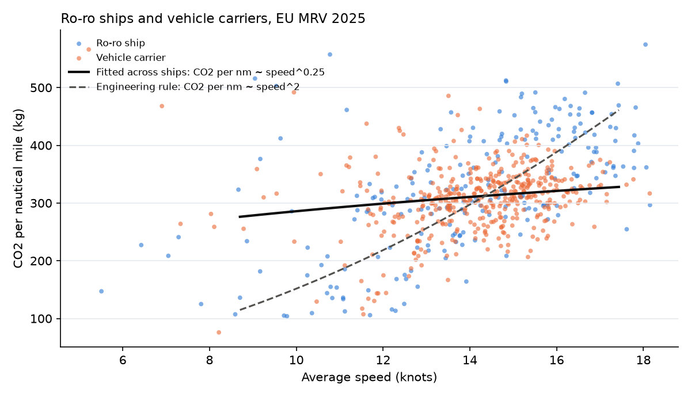

# Shipping performance analytics

Fuel, CO2, EU carbon cost and port time of vehicle carriers and ro-ro ships, built from public EU emission reports, Norwegian ship tracking data, weather and carbon prices, and modelled with dbt and Power BI.
The analysis finds that ship size and design generation explain far more of the differences in CO2 per mile than speed does in annual data, that many ships drift toward the poor end of the IMO carbon rating, and that waiting at anchor is rare on the Norwegian coast.

**Live demo: https://shipping-performance-analytics.azurewebsites.net**



## Questions and short answers

<!-- BEGIN:answers -->
| Question | Short answer |
|---|---|
| What drives fuel efficiency differences? | Size first: doubling gross tonnage goes with 29.6% more CO2 per nautical mile; the newer EEDI design generation emits 6.1% less. Annual data show a weak speed effect (exponent 0.25, 95% interval 0.17 to 0.33). |
| What would slower steaming save? | At 10% slower: 2.6% less CO2 on the estimate from MRV data, 19.0% on the engineering rule, for about 13.2 extra days at sea per ship per year (2025, 750 ships). |
| Which ships drift toward poor carbon ratings? | 37.1% of rated ship-years were D or E in 2025 (95% interval 33.4% to 40.8%); 116 of 520 ships rated worse than in 2023. |
| How much time is lost waiting at Norwegian ports? | Little: 0.3% of 664 calls waited at anchor; median 3.9 h at berth. Wind and waves change leg speed by at most 5.9%, with overlapping intervals. |
| Which ship-years deviate from what speed, size and age predict? | 229 of 5,131 ship-years (112 above, 117 below expectation), as candidates for review. |
<!-- END:answers -->

Methods, intervals and the full result tables are in [docs/analysis.md](docs/analysis.md).

## What is inside

| Part | What it is | Where |
|---|---|---|
| Data warehouse | A dbt project on DuckDB: staging, intermediate and a star schema of four fact tables and four conformed dimensions, with a slowly changing ship dimension. Tests on every model. | [dbt/](dbt), [docs/data-model.md](docs/data-model.md) |
| Power BI semantic model | A Power BI project (PBIP) with the model in TMDL: documented measures in display folders, a time intelligence calculation group, a metric field parameter, what-if parameters and row-level security roles. Checked with the Best Practice Analyzer and reconciled against SQL. | [powerbi/](powerbi), [docs/power-bi.md](docs/power-bi.md), [docs/measures.md](docs/measures.md) |
| Power BI report | Interactive report pages in the enhanced report format, with drill-through, a tooltip page, bookmarks and a self-service "Explore" page. A PDF export of every page is in [powerbi/exports](powerbi/exports). | [powerbi/ShippingPerformance.Report](powerbi/ShippingPerformance.Report) |
| Paginated report | A printable segment performance report for Power BI Report Builder, with parameters. | [powerbi/paginated](powerbi/paginated), [docs/paginated-report.md](docs/paginated-report.md) |
| Analysis | Drivers of fuel efficiency, slow steaming scenarios, carbon rating drift, port waiting and weather, and deviations, each with uncertainty intervals. | [src/spa/analysis](src/spa/analysis), [docs/analysis.md](docs/analysis.md) |
| AI analyst | A tool-using AI analyst over the warehouse (metric catalog and read-only SQL) and an insight writer whose every number is checked, both evaluated on frozen questions. | [src/spa/ai](src/spa/ai), [docs/ai-analyst.md](docs/ai-analyst.md) |
| Demo | A FastAPI and React site. The home page asks one question, should ships sail slower, and answers it with one chart and two sliders (speed and the cost of a day at sea); prices, ship type, CO2 and carbon ratings are one step further. Further pages reproduce the report logic, with a guided tour. | [demo/](demo) |
| Automation | One command refreshes everything; freshness and quality checks; GitHub Actions CI. | [docs/operations.md](docs/operations.md) |
| Microsoft Fabric | Built Fabric-ready: medallion layers as Delta tables and a mapping to Fabric items. | [docs/fabric.md](docs/fabric.md) |

### Data

<!-- BEGIN:data -->
| Data | Volume |
|---|---|
| EU MRV ship-year reports (ro-ro ships and vehicle carriers, 2018 to 2025) | 5,692 reports, 1,042 ships |
| AIS positions on the Norwegian coast (5 August to 30 September 2026) | 245,894 positions, 36 ships |
| AIS-derived port calls and voyage legs | 666 calls, 605 legs |
| Data snapshot (content hash of the gold tables) | `dc2606ccbd44` |
<!-- END:data -->

### Model quality

<!-- BEGIN:quality -->
| Check | Result |
|---|---|
| DAX measures that evaluate without error | 57 of 57 |
| Key measures equal to SQL (relative tolerance 1e-06) | 48 of 48 |
| Row-level security roles tested in the engine | 2 of 2 |
| Best Practice Analyzer findings (71 rules) | 0 |
<!-- END:quality -->

### AI analyst evaluation

<!-- BEGIN:ai -->
| Model | Test accuracy (95% interval) | Dev accuracy | Median seconds per question | Insight findings fully supported |
|---|---|---|---|---|
| Gemini 3.5 Flash Lite (free tier) | 97% (83% to 99%), 29/30 | 100% | 4.3 | 100% |
| Qwen 2.5 7B (local, Ollama) | 13% (5% to 30%), 4/30 | 10% | 54.5 | 67% |
| Llama 3.2 3B (local, Ollama) | 3% (1% to 17%), 1/30 | 10% | 22.7 | 53% |
<!-- END:ai -->

## Open the Power BI files

1. Install [Power BI Desktop](https://www.microsoft.com/en-us/download/details.aspx?id=58494) (free) and clone this repository.
2. Open `powerbi/ShippingPerformance.pbip`. The model reads the gold Parquet files in `data/exports/gold`, by default straight from this repository on GitHub. To read a local copy instead, set the `DataFolder` parameter (Transform data, Edit parameters) to the full path of the `data\exports\gold` folder in your clone, for example `C:\Projects\shipping-performance-analytics\data\exports\gold`.
3. Click Refresh.
4. For the paginated report, open `powerbi/paginated/SegmentPerformance.rdl` in [Power BI Report Builder](https://www.microsoft.com/en-us/download/details.aspx?id=58158) (free) and click Run. Its data is built into the file.

## Data and licences

EU MRV emission reports (European Maritime Safety Agency), AIS positions, port calls and the location register from the Norwegian Coastal Administration (Kystverket, Norwegian licence for open government data), weather from [Open-Meteo.com](https://open-meteo.com) (CC BY 4.0, ERA5 from the Copernicus Climate Change Service), EU ETS allowance prices from Ember (CC BY 4.0) and coastline from Natural Earth (public domain). Details and attribution text: [DATA_NOTICE.md](DATA_NOTICE.md). Ships are shown only under stable pseudonyms such as "Carrier 017"; names, IMO numbers and MMSI numbers stay in the local raw layer and are never published.

## How to run

Requirements: Python 3.11, Node.js 20 or later. On Windows, Power BI Desktop and Tabular Editor 2 for the Power BI steps; Ollama for the local AI models.

```bash
python -m venv .venv
```

Windows:

```bash
.venv\Scripts\activate
```

Linux or macOS:

```bash
source .venv/bin/activate
```

Then:

```bash
pip install -e ".[dev]"
```

```bash
spa refresh
```

`spa refresh` downloads every source (resuming where it stopped), builds and tests the warehouse, writes the exports, runs the analysis, evaluates the AI analyst from cached model calls, regenerates the Power BI files, the demo data and these README tables, and prints the data status table. Each step also runs on its own: `spa ingest`, `spa build`, `spa export`, `spa analyze`, `spa ai eval`, `spa powerbi`, `spa demo-export`, `spa docs`, `spa status`.

Run the demo locally:

```bash
cd demo/frontend && npm ci && npm run build && cd ../.. && python -m uvicorn demo.backend.app:app --port 8000
```

## Tests

```bash
pytest
```

The tests build the warehouse from small synthetic fixtures and check port call detection, the EU ETS and CII calculations against hand-computed values, the scenario arithmetic, the read-only SQL guard, the number checker, the source parsers, the Power BI files against Microsoft's schemas, the paginated report against the RDL schema, privacy (no real identifiers in any published file) and that these README tables match the result files. CI runs the same on GitHub Actions, plus the Best Practice Analyzer on Windows and a build and smoke test of the demo.

## Limits

- MRV data covers voyages to, from and between EU/EEA ports, so carbon ratings here approximate the official IMO figure, which covers all voyages.
- MRV time at sea includes waiting at anchor, so annual average speed understates sailing speed and weakens the measured speed effect.
- MRV publishes no gross tonnage or build year: tonnage is reported by Kystverket where a ship called Norway and otherwise estimated from AIS length and beam; the design generation (EEDI or not) stands in for build year.
- The AIS part covers fleet ships seen on the Norwegian coast in August and September 2026, not the whole fleet or the whole year.
- The fuel price is a documented scenario input, not a market series.

## Licence

MIT, see [LICENSE](LICENSE). Developed by Reza Azad Gholami.
