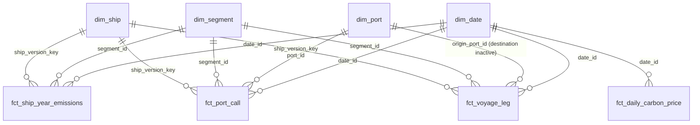

# Data model

The warehouse is a [dbt](https://www.getdbt.com) project on DuckDB (an embedded analytical SQL database) in `dbt/`. It turns raw Parquet files into a star schema: fact tables that record events or yearly reports, surrounded by dimension tables that describe them. The same star schema is exported as gold Parquet and Delta tables and loaded by the Power BI semantic model.

## Layers

| Layer | Schema | What happens | Examples |
|---|---|---|---|
| Sources | read from `data/raw` | Raw Parquet files, read in place | MRV reports, AIS positions, port calls, weather, carbon price |
| Staging | `staging` (views) | One model per source: types, names, units, UTC times, filters to the fleet and to the data end date | `stg_mrv__ship_year`, `stg_ais__positions` |
| Intermediate | `intermediate` | Business logic: identity linking, pseudonyms, gross tonnage, EU ETS and CII, stop detection, port calls, weather on tracks | `int_ship_year`, `int_port_calls` |
| Marts | `marts` | The star schema used by Power BI, the analysis, the AI analyst and the demo | `fct_ship_year_emissions`, `dim_ship` |
| Seeds | `reference` | Rule tables kept in CSV with their sources | CII parameters, EU ETS phase-in |

## Star schema

### Grain

The grain is the meaning of one row. Each fact table has exactly one:

| Table | Grain | Main measures |
|---|---|---|
| `fct_ship_year_emissions` | one ship in one EU MRV reporting year | fuel, CO2, distance, hours at sea, speed, EU ETS scope and cost, CII attained, required and rating |
| `fct_port_call` | one AIS-derived call of one ship at one Norwegian port | waiting hours at anchor, hours at berth, Kystverket confirmation |
| `fct_voyage_leg` | one leg between two consecutive calls of one ship | distance along the track, steaming hours, speed, wind, waves |
| `fct_daily_carbon_price` | one calendar day | EU ETS allowance price |

### Conformed dimensions

A conformed dimension means the same thing in every fact table it joins. `dim_segment`, `dim_date`, `dim_ship` and `dim_port` are shared, so a filter on segment in Power BI reaches the yearly emissions, the port calls and the voyage legs at once. Relationships use integer surrogate keys.

### Slowly changing ship attributes

`dim_ship` is a type 2 slowly changing dimension: a ship's segment, flag region and state, ice class and efficiency index type can change between reporting years, and each change starts a new version row with `valid_from_year` and `valid_to_year`. Yearly facts point to the version that was valid in their year (`ship_version_key`), so a ship that moved from one flag to another is counted under the right flag in each year; `ship_key` stays the same across versions. Port calls and voyage legs from 2026 use the current version.

### Pseudonyms and privacy

`int_fleet_ships` gives each IMO number a salted hash and a stable pseudonym such as "Carrier 017" (the rank of the hash within the segment). Only the pseudonym and the surrogate keys reach the marts; a test checks that no identifier column exists there.

## How the main logic works

**Distance and speed.** MRV publishes fuel per nautical mile, not distance, so distance is total fuel divided by fuel per mile, and average speed is distance divided by time at sea.

**Quality checks.** A ship-year is used for efficiency measures only when its distance, time at sea, speed and carbon factor (CO2 per tonne of fuel) are physically plausible (`is_quality_ok`).

**Gross tonnage.** MRV has no tonnage. Where a ship called Norway, Kystverket's port call records give its gross tonnage (accepted only when it is plausible for the ship's AIS length and beam, which rejects matches on shared ship names). Otherwise tonnage is estimated from AIS length times beam with a log-log fit per segment, calibrated on the ships that have both.

**Port calls from AIS.** Kystverket's positions are vertices of simplified tracks, so a ship lying still has few positions, often hours apart. A stop is therefore found on the step between two positions: the implied speed (distance over elapsed time) is below one knot. Consecutive stationary steps form a stop episode (the gaps-and-islands pattern in SQL). A stop within 1 km of a quay, terminal or harbour point is a berth stop; a stop further out but within 25 km of a port is anchoring. Consecutive berth stops at the same port form one call, and anchoring at the same port within 24 hours before berthing is waiting time. Each call is cross-checked against Kystverket's own port call records.

**Weather on tracks.** Positions under way are matched to the hourly wind (0.25 degree cells) and wave (0.5 degree cells) value of their cell.

**EU ETS and CII.** See [carbon-rules.md](carbon-rules.md).

## Tests

dbt tests run on every build: unique and not-null keys, relationships between facts and dimensions, accepted values (ratings, stop types), accepted ranges (speeds, shares, tonnage, prices), a check that no record is dated after the data end date, and freshness checks that the latest port call and carbon price are within a week of it. Seeds carry their own tests. The lineage graph is on the demo's "How it is built" page and in `dbt docs` (`dbt docs generate --project-dir dbt --profiles-dir dbt`).
